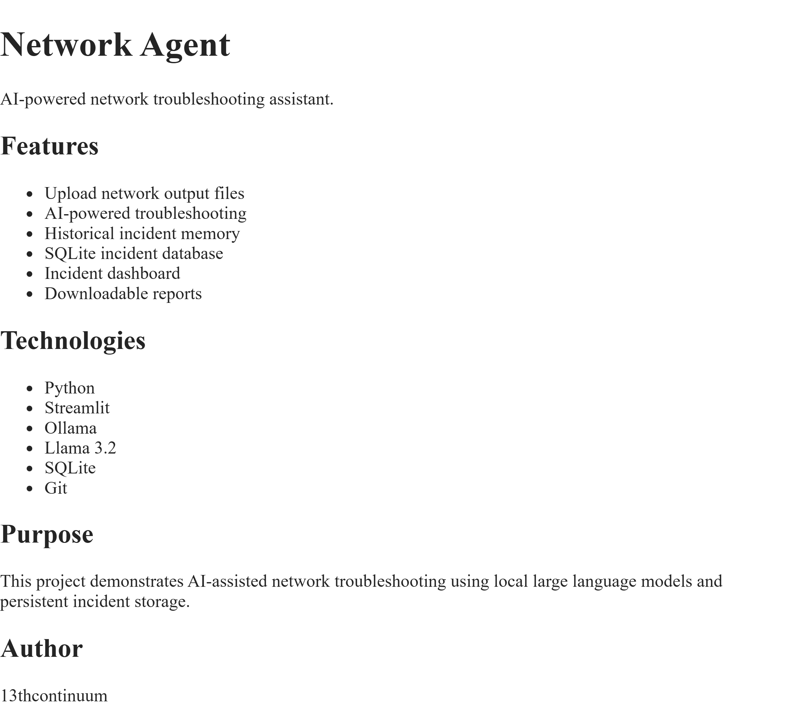

# Network AI Agent

Analyze uploaded network-device output with Ollama and review past incidents.

## Setup

1. Install the dependencies with `pip install -r requirements.txt`.
2. Install and start Ollama, then download the default model with
   `ollama pull llama3.2`.
3. Optionally set `OLLAMA_MODEL` to use a different model name.

## Run

- Start the Streamlit app with `streamlit run app.py`.
- Run the command-line analyzer with `python main.py`; it reads
  `router_output.txt`.

Both entry points use `network_agent.db` for incident history. Relevant
previous incidents are selected from recent database records and limited to
three entries and 6,000 characters in each analysis prompt. The
`memory/incidents.txt` file is not used by the app.

Run the focused tests with `python -m unittest`.

